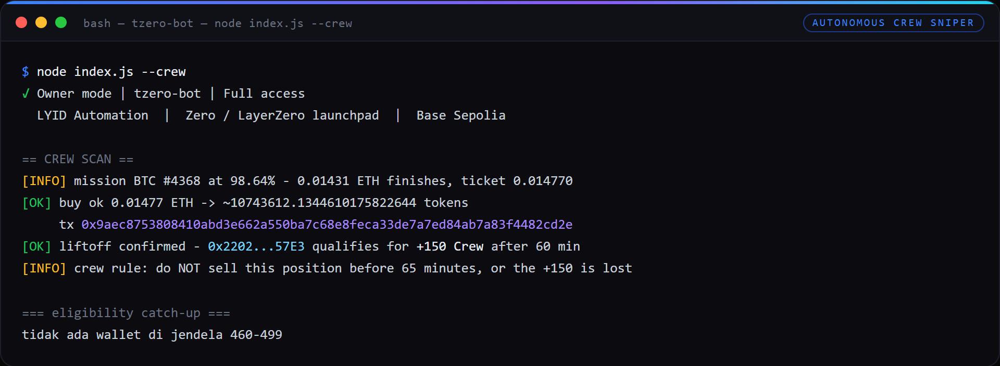
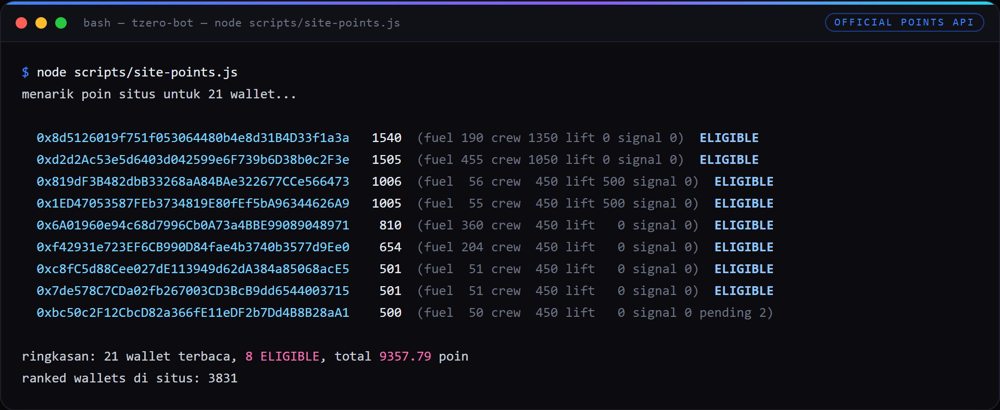
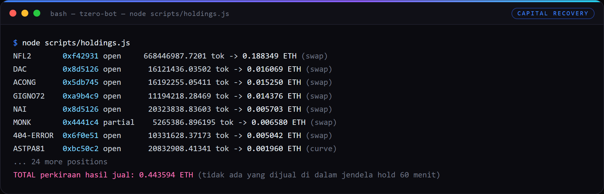
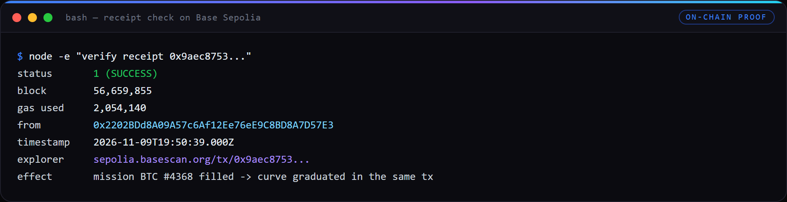

# TZERO BOT — LYID Automation

Automation for **Tzero**, the launchpad for **Zero** (LayerZero's L1), running on **Base Sepolia**
(chain 84532). Season 0 **Pre-flight Points** is live now; Zero mainnet is expected Q4 2026, so every
action below is early positioning on free testnet ETH.

Built by [LYID — Layer Airdrop ID](https://t.me/layerairdrop) · Telegram [@rmndkyl](https://t.me/rmndkyl)

**What this is:** a working testnet bot, sold as source. You bring your own wallets and your own
faucet ETH. Nothing here requires real money, and nothing here promises a payout — the value is the
automation, the measured point economics, and the mistakes already paid for.

---

## Proof it runs

Every screenshot below is captured from this bot's own log files and live reads — not a mockup.

**Autonomous crew snipe.** A mission sitting at 98.64% is finished in one buy, and the liftoff is
confirmed inside the same transaction:



**Official points, straight from the project's own API.** The local estimator is only a fallback;
eligibility is decided by these numbers:



**Capital recovery.** Every still-held position quoted on its correct venue (curve before liftoff,
TzeroSwap after), with nothing sold inside the 60 minute hold window:



**On-chain receipt of the snipe above**, checked over RPC:



---


## The point rules decide the whole design

Copied from https://testnet.tzer0.fun/docs/points (read 2026-11-08) and enforced in `src/points.js`:

| Source | Points | Rule that actually bites |
|---|---|---|
| **Fuel** | 1,000 per 1 ETH bought | Must be **held 60 minutes**. Anything sold or sent inside 60 min does not count, and a sale is matched against your **most recent buys first**. Buys under **0.0005 ETH earn zero**. Max **1 ETH of buys per wallet per UTC day**. Buys on your own mission earn nothing. |
| **Crew** | +150, max 5/day | A mission you backed must **lift off**; you need **≥ 0.01 ETH bought on its curve**, held 60 min, still holding at liftoff. |
| **Liftoff** | +500 | Creator of a mission that lifts off with **≥ 5 other wallets** backing it (0.01 ETH+ each, held 60 min). Launching alone earns nothing. |
| **Staking** | 5,000/day shared | Pro-rata, capped at 1,000/day/wallet, denominator at least 10,000,000 T0. |
| **Signal** | +200 / +100 | Reply or quote the announcement post on X with your wallet code, paste the link, sign a message. Manual — the bot does not touch X. |
| **Eligibility** | 500 | Below 500 points a wallet gets nothing. |

Two consequences drove this version:

1. **Selling early destroys points.** The old daily loop bought 0.00025-0.00065 ETH and sold 40% seconds
   later - below the Fuel floor *and* inside the hold window. It earned zero, every run. Buys are now
   written to a ledger and only sold by a separate `--settle` step, 65 minutes later.
2. **Fuel is the expensive way to 500 points.** 500 Fuel points needs 0.5 ETH of held buys per wallet.
   Crew is 12x cheaper per point, so the bot's budget logic leans on Crew and Liftoff.

Testnet calibration measured on 2026-11-08: a fresh curve lifts off after **~0.28 ETH** of net buys
(`quoteBuy(1 ETH).refund` gives the exact remaining cost for any mission).

## What the bot does

| Mode | Command | What it does |
|---|---|---|
| Read + status | `--status` | tokenCount, creation fee, newest open missions |
| Quote | menu 2 | buy/sell estimate, no gas |
| Fuel run | `--daily` | Buy >=0.0006 ETH on 2-4 missions and **hold**; optional mission launch; claim creator fees |
| Settle | `--settle` | Sells only positions that already passed the 60 min hold |
| Crew sniper | `--crew` / `--crew-scan` | Finds missions where one buy finishes the curve, buys the last slice (3M gas) -> +150 Crew. Scans up to 3,000 recent missions through Multicall3 (~13 s for 2,000), so a mission that sits at 88% for hours is still visible |
| Crew train | `--crew-train` | 5 wallets each back the same near-liftoff mission (>=0.01 ETH) -> 5 x +150 if it lifts |
| Group buy | `--gb --create` / `--back` / `--fill` / `--gb --gb-status` | 1 creator + 5 backers on our own mission -> +500 Liftoff and +150 per backer |
| Points | `--points` | Local estimate per wallet (fuel, crew, liftoff) + live site check |
| Site points | `scripts/site-points.js` | **Authoritative**: pulls `/api/points/<addr>` for every wallet into `data/site-points.json` (total, fuel, crew, liftoff, staking, signal, eligible, rank, per-action list). The local estimator is known to be off by 150-300 crew, so use this for eligibility decisions |
| Sweep | `--sweep` | Consolidates dust into N wallets so a 0.01 ETH Crew buy is possible |
| Staking | `--stake`, `--stake --buy <eth>`, `--stake --claim-rewards`, `--stake --unstake`, `--stake --stake-report` | $T0 stake/unstake/claim with an honest yield readout |
| Launch / claim | `--launch`, `--claim` | Create a mission, claim creator fees |
| Helper | `scripts/balance.js` | Balance snapshot of every wallet in `privateKey.txt` |
| Helper | `scripts/holdings.js` | Quotes every still-held token on its correct venue -> recoverable ETH |
| Helper | `scripts/fuel-topup.js <addr> <eth>` | Buys an exact amount on a random non-own mission and records it (used to push a wallet over 500) |
| Helper | `scripts/send.js <from> <to> <eth>` | Manual one-off transfer. Rescues only: every transfer between your own wallets is one more on-chain link |
| Helper | `scripts/sepolia.js` | Relay bridge Sepolia -> Base Sepolia (`info` / `quote` / `bridge --execute`) |
| Helper | `scripts/eligibility-catchup.js` | Buys just enough Fuel to push a 460-499 point wallet over 500 (max 1 per run) |
| Helper | `scripts/check-position.js <SYMBOL>` | Age + sell quote + pool reserves for one held position |
| Helper | `scripts/exit-position.js <SYMBOL> [pct]` | Sells a symbol now, bypassing the per-persona settle window (use when the pool price spikes) |

Everything is wrapped in per-wallet try/catch, a balance guard, randomized delays and a slippage cap.

## Features

| Feature | Status |
|---|---|
| Read layer (stats, missions, quotes, remaining-to-liftoff) | working |
| Buy + HOLD with a per-buy ledger (`data/positions.json`) | working, live-tested |
| Settle that refuses immature positions | working, live-tested |
| Daily Fuel cap (1 ETH/day/wallet) | working |
| Crew sniper (buy the last slice, 3M gas) | working, live-tested; now prefers wallets still under 500 points |
| Crew train (5 wallets on one mission) | implemented, needs 5 funded wallets |
| Group-buy state machine with 65 min hold | implemented, needs ~0.29 ETH |
| Points estimator + site API probe | working; the site went live 2026-11-10, so `scripts/site-points.js` is now the authoritative view |
| Staking + honest yield math | working, yield is negligible on testnet |
| Dust sweep into N wallets | working, executed 14 transfers |
| Multi-wallet, `--limit N`, `--dry-run`, license gate | working |

## Requirements

| Item | Required? | Cost |
|---|---|---|
| Node.js 18+ (tested on v26) | yes | free |
| Base Sepolia test ETH | yes | free (faucet) |
| One private key per wallet | yes | free |
| Real money | **no** | Rp 0 |

Faucets that worked in this project: `console.optimism.io/faucet` (GitHub login, ~0.1 ETH per claim).
The CDP Coinbase faucet works with an account. Most other Base Sepolia faucets were dead or gated.

## Point economics, honestly

Measured on 2026-11-08 with 0.09 ETH of testnet ETH in the fleet:

| Play | Cost | Points | Notes |
|---|---|---|---|
| Fuel | 0.001 ETH | 1 | 500 points = 0.5 ETH held per wallet. Not affordable at fleet scale. |
| Crew sniper | 0.012-0.05 ETH | 150 | Only when a mission is already near liftoff. Windows last minutes. |
| Crew train | ~0.0525 ETH | 750 (5 x 150) | Best points per ETH, needs 5 wallets holding >=0.011 ETH each. |
| Group buy (own mission) | ~0.286 ETH | 1,250 (500 + 5 x 150) | Guaranteed liftoff, most expensive. |
| Staking | ~213 ETH for 1M T0 | ~5/day | Dead on testnet: 935M T0 already staked. |

Realistic path: **crew train whenever a near-liftoff mission exists, one group-buy cycle when the fleet
can afford it, and never sell inside the hold window.**

## Setup

Cara termudah di Windows: klik dua kali **JALANKAN.bat** (menu berbahasa Indonesia), atau
**CEK-POIN.bat** untuk melihat poin saja. Panduan klik-per-klik ada di `PANDUAN-MANUAL.md`.

Lewat terminal:

```bash
cd tzero-bot
npm install
cp config.json.example config.json
cp privateKey.txt.example privateKey.txt   # one key per line; every key farms
node index.js --status
node index.js --daily --dry-run --limit 1
node index.js --daily
node index.js --points
```

Interactive menu (`node index.js`) exposes 16 actions, including settle, crew, group buy and staking.

## Usage (cron-friendly)

```bash
node index.js --daily                 # fuel run, buys and holds
node index.js --settle                # sell only positions older than 65 min
node index.js --crew-scan             # is anything about to lift off?
node index.js --crew --limit 1        # snipe one
node index.js --crew-train            # 5 wallets on one near-liftoff mission
node index.js --gb --create           # start a cycle (needs ~0.29 ETH)
node index.js --gb --back             # 5 backers buy in
node index.js --gb --fill             # finish the curve after the hold window
node index.js --points                # where do we stand?
node index.js --sweep --limit 6       # consolidate dust
```

Suggested schedule: `--daily` once a day, `--settle` two hours later, `--crew-scan` every 15 minutes
(windows are short), `--gb` whenever a cycle is open.

The cron wrapper shipped for this bot adds two things the raw
commands do not: a **random 0-4 minute delay** so the runs are not metronomic, and a **lock file**
(`data/crew.lock`) so two runs never overlap. It runs `--crew`, then `eligibility-catchup.js`, and it
does **not** fire `--crew-train` automatically: five wallets buying the same mission within minutes is
the most scripted-looking thing this bot can do, so the train is manual only.

Cron jobs in use:

| Job | Schedule | Script |
|---|---|---|
| `tzero-crew-sniper` | every 15m (delayed 0-4m) | `tzero-crew.py` |
| `tzero-fuel-ladder` | every day 09:30 WIB | `tzero-ladder.py` |
| `tzero-gb-driver` | every 10m while a cycle is open | `tzero-gb.py` |
| `tzero-settle-daily` | every day 21:30 WIB | `tzero-settle.py` |
| `tzero-settle-once` | one-shot after a run | `tzero-settle.py` |
| `tzero-gb-fill` | every 5m, only while a cycle needs it | `tzero-gb-fill.py` |

Windows Task Scheduler:

```
schtasks /create /tn "tzero-daily"  /tr "node C:\Users\<user>\tzero-bot\index.js --daily"  /sc daily /st 09:00
schtasks /create /tn "tzero-settle" /tr "node C:\Users\<user>\tzero-bot\index.js --settle" /sc daily /st 12:00
```

## Wallet fleet

Every line in `privateKey.txt` is a farming wallet. **There is no funding wallet in 1.0.3**: the bot never sends ETH from one of your wallets to another, because a single wallet fanning gas out to the rest is the easiest cluster to fingerprint.

| Where | What |
|---|---|
| your own key vault | any format you already use: label / seedphrase / private key / address |
| an encrypted store (optional) | seedphrase AES-encrypted, if you keep one |
| `privateKey.txt` | what the bot reads, one key per line |

After the 2026-11-08 sweep the fleet is 6 funded wallets (0.011-0.024 ETH each) and 15 dust wallets.
That is deliberate: Crew needs 0.01 ETH from a single wallet, so 21 wallets at 0.004 could never act.

Since 2026-11-09 every farming wallet holds at least 0.017 ETH (17 top-ups, 0.2968 ETH total), and the
two wallet closest to the 500 bar (0x7de5, 0xbc50) hold 0.034 each so they can take any snipe (max 0.03).

### Funding: Sepolia -> Base Sepolia (Relay)

`scripts/sepolia.js` bridges native ETH through the **testnet** Relay API
(`https://api.testnets.relay.link` — the main `api.relay.link` does not list Sepolia).

```bash
node scripts/sepolia.js info                                   # bridge wallet + Sepolia balance
node scripts/sepolia.js quote 0.5 0x7490...A01                 # fee + expected output, no tx
node scripts/sepolia.js bridge 0.5 0x7490...A01 --execute      # sign + send the deposit tx
# repeat the bridge for each wallet, or use the faucet per wallet
```

Keys: keep the bridge wallet's key out of `privateKey.txt` and out of the repo. Relay accepts any
`recipient`, so a bridge can land straight on the wallet you want to top up. Bridging one wallet and
fanning it out locally is cheaper, but it creates the star graph described below - the bot no longer
offers that shortcut.

## Anti-detection, and the sybil review

The point docs say it plainly: before the snapshot a **public sybil review removes farm clusters -
groups of wallets funded from the same source that act together - and scripted patterns.**

### Persona per wallet (`src/humanize.js`)

Uniform randomness is still a fingerprint: if every wallet draws from the same range, two wallets are
statistically identical. Each wallet now gets a **stable persona derived from its address** (SHA-256 ->
seeded PRNG), so it keeps its own habits every run and no two wallets behave alike:

| Knob | Range | What it changes |
|---|---|---|
| `sizeBias` | 0.80-1.32 | buy size relative to the config band |
| `missions` | 2-4 | missions traded per run |
| `sellMin`/`sellMax` | 20-70% | how much of a position it exits |
| `slipMinBps`/`slipMaxBps` | 140-560 | slippage tolerance |
| `restDayProb` | 4-14% | chance of staying quiet |
| `launchProb` | 35-80% | chance of launching a mission |
| `tempoMult` | 0.55-1.9 | pause length between actions |
| `crewTicketEth` | 0.0102-0.0165 | slice size when backing a liftoff |
| `gasPremium` | 1.00-1.22 | gas price multiplier |
| `settleAfterMin` | 72-180 | when this wallet exits a mature position |

`node index.js --personas` prints the whole table for inspection.

On top of personas:

- **Non-round amounts.** Every size is nudged +-1.5% and written with 6 decimals, so nothing lands on
  0.0005 / 0.0105 style numbers.
- **Log-normal tempo.** Pauses cluster short with occasional long ones, clamped per run, instead of a
  flat `randomInt(min,max)`.
- **Exit stagger.** `--settle` uses each wallet's `settleAfterMin`, so the fleet does not sell at the
  same minute (disable with `humanize.staggerSettle: false`).
- **Gas premium per wallet.** The node's price is nudged by that wallet's persona instead of every tx
  paying the identical amount.
- **RPC rotation.** Wallets are spread over `humanize.rpcPool` (default: sepolia.base.org,
  base-sepolia.publicnode.com, 84532.rpc.thirdweb.com) so one provider does not see the whole fleet.
- **Fill delay.** A group-buy cycle decides its own fill offset at creation (66-150 min) instead of
  every cycle filling exactly 65 minutes after the last backer.
- **Backer tickets and order.** Backers buy slightly different sizes in a shuffled order, not 5 x
  0.0105 in file order.

What that still does not fix: the funding graph, wallet age, and the fact that several wallets
backing the same brand-new mission is coordination by construction. Persona changes texture, not
topology.

What it cannot hide:

- **A star funding graph, if you create one.** The bot no longer funds wallets from a single source
  (1.0.3), but if every wallet is topped up from the same exchange account or the same faucet identity,
  the graph is still visible on-chain. Only you can avoid that.
- **Same RPC provider** for every wallet (one IP on the provider side).
- **Fresh wallets created the same day**, first activity clustered.
- **A crew train is by definition "wallets acting together".** Five buys of ~0.0105 ETH on one mission
  within minutes is the exact pattern the review describes.

The only real mitigation is funding independence: each wallet claimed from a faucet (or withdrawn from
an exchange) on its own identity, spread over days, with different behaviour. The bot can no longer
move ETH between wallets at all, so nothing it does re-links them.

### Wallet independence (1.0.3)

`--fund`, the funding wallet (line 1 of `privateKey.txt`) and `scripts/distribute.js` are gone. Every key
in `privateKey.txt` is now an equal farming wallet, and the bot never sends ETH from one of your wallets
to another.

Why: one wallet paying gas to twenty wallets is a star graph. Whoever reviews the snapshot sees a single
address with twenty outbound transfers and can drop the whole cluster, no matter how random the amounts
or the delays look. This is the same pattern the project's published sybil review describes.

How to fund a fleet now:

| Option | Notes |
|---|---|
| Faucet per wallet | cleanest: different days, own identity, and its own proxy line if you have one |
| Testnet bridge straight to each wallet | `node scripts/sepolia.js bridge <eth> <wallet> --execute`; Relay accepts any recipient |
| Exchange/faucet withdrawal per address | one withdrawal each, slightly different amounts and days |

`--sweep` still exists because Crew needs one wallet holding 0.01 ETH, but it is manual, it is never part
of `--daily`, and it does link the dust wallets to the targets on-chain. If cluster hygiene matters more
to you than Crew, skip it and fund a single wallet properly instead.

## Configuration (`config.json`)

| Key | Default | Meaning |
|---|---|---|
| `daily.minBalanceEth` | 0.0012 | skip wallets below this |
| `daily.buyAmountMinEth` / `MaxEth` | 0.0006 / 0.0012 | Fuel buy size, floor is the 0.0005 rule |
| `daily.holdMinutes` | 65 | how long before `--settle` may sell |
| `daily.fuelDailyCapEth` | 1 | per-wallet daily Fuel cap |
| `daily.sellPercentMin` / `Max` | 25 / 65 | settlement sell size |
| `daily.createMission` / `launchProbability` | true / 0.55 | own mission launch |
| `daily.minHoursBetweenRuns` | 20 | resume guard for batches |
| `crew.scanMissions` | 2000 | missions scanned for near-liftoff (read via Multicall3, max 3000; ~13 s) |
| `crew.minProgressBps` | 8500 | only scan missions above 85% |
| `crew.maxFillEth` | 0.03 | max ETH a snipe may cost |
| `crew.minBuyEth` | 0.0103 | Crew needs 0.01, keep a buffer |
| `crew.maxPerRun` / `dailyCap` | 1 / 5 | snipes per run / Crew awards per day |
| `crew.trainSize` / `trainAmountEth` | 5 / 0.0105 | crew train shape |
| `gb.backers` / `backAmountEth` | 5 / 0.0105 | group buy shape |
| `gb.initialBuyEth` | 0.012 | creator's opening buy |
| `gb.holdMinutes` | 65 | wait after the last backer before filling |
| `sweep.targets` | 6 | wallets dust is consolidated into |

## Verification status (honest)

| Module | Status | Evidence |
|---|---|---|
| Read layer | **verified live** | 3,746 missions, creation fee 0.0001 ETH, curve supply 793.1M |
| `buy` + hold + ledger | **verified live** | 2026-11-08: 0.0006 ETH buy, tx `0x098f2fe39f1c14a9dc99eda34f2fe11f400d6cb993e3d20ac96a456fe96c3e99` |
| Settle refuses immature | **verified live** | same position: `settle actions: 0, skippedImmature: 1`; after simulating 70 min it sells (dry) |
| Fuel cap enforcement | **verified** (code path + ledger math) | `capRemaining` uses the same ledger the settle test wrote |
| Sweep | **verified live** | 14 transfers, all status 1, 6 targets funded 0.0112-0.0241 ETH |
| `fillQuote` / remaining-to-liftoff | **verified live** | 0.286 ETH on a fresh mission, 0.0999 on an 87% mission after sells |
| Crew sniper | **verified live** | 4 snipes landed autonomously: ONDO #4382 (tx `0xe058fe34...`), BTC #4368 (tx `0x9aec8753...`), plus T0EX #3909 and ABB #3948. Each liftoff confirmed in the same tx -> +150 Crew |
| Crew sniper scan depth | **verified by measurement** | 2,000 missions through Multicall3 in ~13 s; a depth probe found 691 missions >=85%, and 3 live candidates were outside the old 250-mission window |
| Group buy create → back → fill | **verified live, full cycle** | CLUB67 `0x2Ae54Da...f345e` graduated at block 56,138,569; create `0xfecd10c2...`, 5 backer txs, fill `0x7416ffd1...` |
| Crew qualification (60 min hold) | **verified from chain timestamps** | 5/5 backers held 66.2–70.5 min at liftoff, 0.0105 ETH each |
| Sell after liftoff (TzeroSwap) | **verified live** | 8 sells after the GRADUATED revert fix, tx `0x06ff458a...` first, all status 1; a thin-pool exit returned 1.61 ETH on a 0.015 ETH position |
| Points — official API | **verified live** | `scripts/site-points.js` reads `/api/points/<addr>`: 21 wallets, **8 eligible**, 9,357.79 points, against 3,831 ranked wallets. The local estimator under-counts Crew by 150–300, so it is only a fallback |
| Fuel ladder (curve only) | **verified live** | 0.1669 ETH into NFL2 #4662 from a 0.169944 top-up; the wallet went 338 -> 504 points and became eligible, tx `0xb1f45ead...` |
| Staking | **reads verified, no funds** | totalStaked 935,284,979 T0, pending() = 0 for every wallet |

### Recent live txs (2026-11-09 → 2026-11-10)

| Action | Result | Tx |
|---|---|---|
| Crew snipe BTC #4368 (98.64%, requires exactly 0.01431) | +150 Crew, graduated in-tx | `0x9aec8753808410abd3e662a550ba7c68e8feca33de7a7ed84ab7a83f4482cd2e` |
| Crew snipe ONDO #4382 (98.45%) | +150 Crew | `0xe058fe34500ed8531757045c38531bce4c97c84ee52b572fe290f28da7f2fa0f` |
| Fuel ladder: buy 0.1669 ETH on NFL2 #4662 | 0xf429 338 -> 504, eligible | `0xb1f45ead1327a946354f53a7dda0e0e177da2cf1f529655010cf37e9a3fb8b63` |
| Exit a position whose pool was thin | 0.015 ETH in -> 1.6106 ETH out | `0xcdb68e10...` |
| Bridge Sepolia -> Base Sepolia (Relay, testnet) | 0.5 ETH, fee ~0.00001 | deposit `0x7f11cf47...`, arrival `0x02bd4d17...` |


### Recent live txs (2026-11-08)

| Action | Tx |
|---|---|
| buy 0.0006 ETH (hold test) | `0x098f2fe39f1c14a9dc99eda34f2fe11f400d6cb993e3d20ac96a456fe96c3e99` |
| sweep 0x2202...57E3 -> 0xd2d2...2F3e | `0xf75ff9b807ca2e8c95a20353b6098cb961d2d654f58bb747a661434cd75512bc` |
| sweep 0xfaf0...0e4a -> 0x1ED4...26A9 | `0x81e2d3c92760e523906182bff9ed552c332afd6670c31449d3907a8f9abf771b` |
| GB create "Club 67" (CLUB67) | `0xfecd10c26a6654a7b4cf0405e2ba468f9348ad499e4fefe28035abd7c9efe82c` |
| GB backer 1-5 | `0xdedb0ef7...`, `0x3823a99f...`, `0xd6a46fea...`, `0xb43366ae...`, `0xb93d9165...` |
| GB fill -> liftoff | `0x7416ffd1580d96bbb400dbf343f36bc009fdf0ce4bc6116c26d1e53fef872d6b` |

### One full group-buy cycle, measured end to end

`Club 67` (CLUB67), token `0x2Ae54Da03fb4Ca3dc19B006B5B32eb4ece3f345e`, graduated at
block 56,138,569 → pair `0xb3fc78846508765f2f647f6A6bd86a240D9C019d`, 793.1M sold.

| Line item | ETH | Result |
|---|---|---|
| creation fee + creator initial buy (0.012) | 0.0121 | creator earns **+500 Liftoff** |
| 5 backers × 0.0105 | 0.0525 | each earns **+150 Crew** |
| fill (bought the rest of the curve) | 0.14965 | liftoff inside our own tx |
| **total cycle cost** | **~0.2143** + gas | **+1,250 points** |

Crew qualification checked against chain timestamps, not hope: all five backers bought
13:42–13:46 UTC, liftoff was 14:53:02 UTC, so each held 66.2–70.5 minutes with tokens still in
the wallet. That satisfies the "0.01 ETH kept 60 minutes, still holding at liftoff" clause.

The project's own points page was stuck at "COUNTING POINTS... 80%" during and after the cycle, so
the site could not be used to confirm the credit. The on-chain conditions are verified; the
crediting itself is the project's side.

## File structure

```
tzero-bot/
├── index.js              # CLI menu (17 actions) + flags
├── src/
│   ├── contracts.js      # addresses + ABIs (launchpad, router, factory, staking, fee splitter)
│   ├── launchpad.js      # read layer (Multicall3) + fillQuote + near-liftoff scan + stake reads
│   ├── actions.js        # buy / sell / create / claim / sweep / settle / daily
│   ├── ledger.js         # per-buy positions, hold windows, daily Fuel cap
│   ├── points.js         # the published point rules + local estimator
│   ├── crew.js           # sniper + 5-wallet crew train
│   ├── gb.js             # group-buy state machine (create -> back -> fill)
│   ├── humanize.js       # per-wallet persona (stable per address) + log-normal tempo
│   └── staking.js        # $T0 stake / unstake / claim / yield report
├── scripts/              # 23 operator helpers (all read-first, --execute to act)
│   ├── site-points.js    # official points for every wallet (authoritative)
│   ├── scan-depth.js     # how deep is the near-liftoff window, which candidates are outside it
│   ├── holdings.js       # quote every held token on its correct venue
│   ├── check-position.js  exit-position.js   fuel-topup.js   fuel-ladder.js
│   ├── eligibility-catchup.js               # push a 460-499 wallet over 500
│   ├── balance.js  send.js                  # balance snapshot + manual one-off transfer
│   ├── sepolia.js                           # Relay bridge Sepolia -> Base Sepolia
│   ├── gb3-bridge.js  gb3-driver.js  gb*-plan-init.js
│   └── legacy-audit.js  vault-extract.js  state-summary.js  status.js
├── utils/                # logger, banner, helpers (saveJson handles BigInt)
├── docs/screenshots/     # the proof images used above
├── data/
│   ├── positions.json    # every buy with its timestamp (gitignored)
│   ├── gb.json           # group-buy cycles (gitignored)
│   ├── state.json        # launches + last run per wallet (gitignored)
│   └── runs.json         # last 60 runs (gitignored)
├── JALANKAN.bat          # double-click menu (Indonesian)
├── CEK-POIN.bat  CEK-STATUS.bat  LIHAT-CRON.bat
├── PANDUAN-MANUAL.md     # click-by-click guide + error table
├── test-hold.js          # operational test: buy, refuse settle, sell after hold
└── license-check.js
```

## Troubleshooting

| Symptom | Cause | Fix |
|---|---|---|
| `daily Fuel cap reached` | 1 ETH of buys already spent today (UTC) | wait for the next UTC day |
| `position(s) still inside the 65 min hold window` | settle ran too early | run `--settle` later; this is the point |
| `no mission is within 0.05 ETH of liftoff` | nobody is close right now | crew is opportunistic; scan again in 15 min |
| `only N/5 wallet(s) hold 0.011 ETH` | that wallet is short of gas | top that wallet up from outside (faucet/bridge); 1.0.3 has no `--fund` |
| `no wallet can afford the initial buy` | group buy needs 0.29 ETH | top up the wallets from outside first |
| buy reverts | price moved past slippage | crew/gb use 9% slippage; daily uses 1.8-4.8% |
| `execution reverted: "GRADUATED"` | selling a mission that already lifted off, on the curve | fixed: sells now check the venue and use TzeroSwap's router after liftoff |
| RPC timeout | public endpoint rate limit | set your own `rpcUrl` |


## What you get

| Item | Detail |
|---|---|
| Full source | `index.js` + `src/` (8 modules) + `utils/` — no compiled or obfuscated files |
| Operator scripts | 23 helper scripts, all read-first (they print a plan and only act with `--execute`) |
| Double-click launchers | `JALANKAN.bat` (menu), `CEK-POIN.bat`, `CEK-STATUS.bat`, `LIHAT-CRON.bat` |
| Guides | `README.md` (this file) + `PANDUAN-MANUAL.md` (click-by-click, error table) |
| License | offline licence check (HWID-bound), ready for the LYID licence server |

## Pricing

| Package | Price | What it is |
|---|---|---|
| Tzero Bot — single | **Rp 120.000 / $8** | this bot, delivered as a ZIP, 90 day licence, HWID-bound |
| Starter bundle | 3 scripts x 0.8 | pick any three bots |
| Pro bundle | all scripts x 0.7 | every bot in the catalogue |
| VIP | monthly flat | Pro + priority updates |

Payment: e-wallet (DANA / GoPay / ShopeePay), bank transfer (BCA / Seabank), or crypto.
Account details are **not** published here — ask [@rmndkyl](https://t.me/rmndkyl).

Free for OG members of [@layerairdrop](https://t.me/layerairdrop): `/claim tzero-bot` in the licence bot.

## Disclaimer

Testnet automation for research and early positioning. No token on mainnet yet, no confirmed airdrop,
no guaranteed reward. Points are provisional until the announced snapshot, and the project's own sybil
review may remove clustered wallets. Never share private keys.

Contact: Telegram [@rmndkyl](https://t.me/rmndkyl) · Channel [@layerairdrop](https://t.me/layerairdrop)
